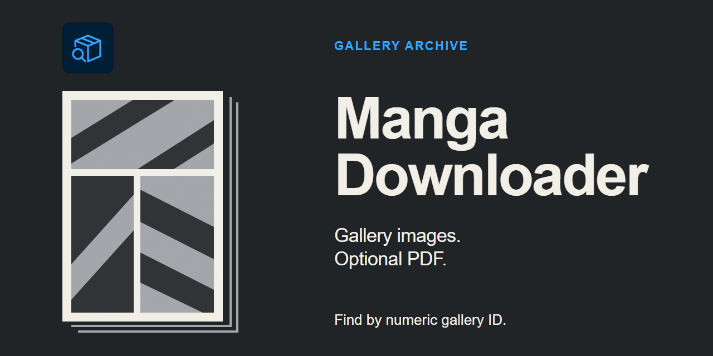
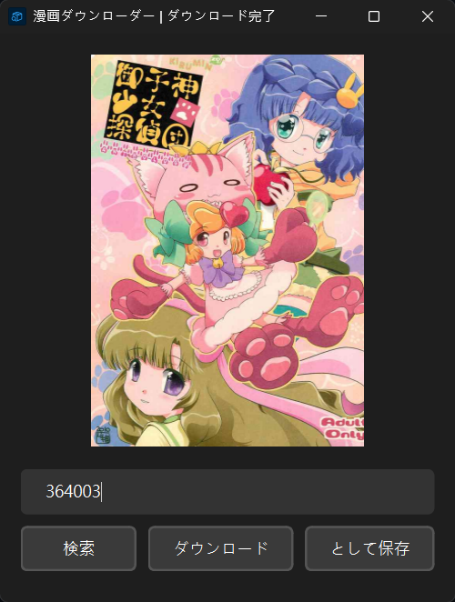

# Manga Downloader



Manga Downloader is a PySide6 desktop application for downloading image galleries from [nhentai.net](https://nhentai.net/) by numeric gallery ID. It previews the cover, derives full-size image URLs from the gallery page, downloads the pages concurrently, and can combine the downloaded images into a PDF.

> The target website contains adult material. Confirm that you meet applicable age and legal requirements, and download only content you are permitted to use.

## Features

- Searches for galleries by numeric ID and displays the cover.
- Extracts gallery titles and image URLs with Beautiful Soup.
- Downloads multiple images concurrently in a background thread.
- Saves images in a gallery-specific folder with zero-padded filenames.
- Creates an optional PDF after the images finish downloading.

## Screenshots



## Setup and run

Run these commands from the repository root. The application reads `setting.ini` and creates `app.lock` relative to the current working directory.

```bash
python -m pip install -r requirements.txt
python app.py
```

## Usage

1. Enter a numeric gallery ID.
2. Select `検索` to load the gallery and preview its cover.
3. Enable `として保存` if you also want a PDF.
4. Select `ダウンロード`, then choose an output directory.
5. Wait until the window title reports that the download is complete.

Downloaded images are stored in a folder named after the gallery:

```text
<selected-directory>/
├── <gallery-title>/
│   ├── 01.<image-extension>
│   ├── 02.<image-extension>
│   └── ...
└── <gallery-title>.pdf
```

The PDF is created only when the PDF option is enabled.

## Configuration

Edit `setting.ini` to control download concurrency and delay:

```ini
[Dowload]
max_workers = 3
delay = 1
```

| Key | Default | Description |
| --- | ---: | --- |
| `max_workers` | `3` | Maximum number of concurrent image downloads |
| `delay` | `1` | Seconds each worker waits after a successful download |

## Current limitations

- Gallery parsing depends on the current HTML structure and image URL format used by `nhentai.net`.
- The search field accepts numeric gallery IDs, not complete URLs.
- Download failures are printed to the console and are not retried or displayed in the interface.
- PDF input files come from `os.listdir()` without explicit sorting, so PDF page order may depend on the filesystem.
- After an HTTP search failure, the current implementation requests gallery `371601` as a fallback before reporting the error. Do not start a download after a failed search.
- An unexpected shutdown may leave `app.lock` behind and prevent the next launch.

## License

The source code is available under the MIT License. See [LICENSE](LICENSE) for details.

Downloaded gallery media is not covered by the repository's MIT License. Its use remains subject to the rights of the original creators and the source website's terms.